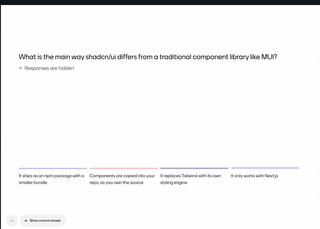
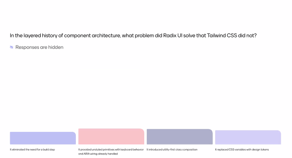
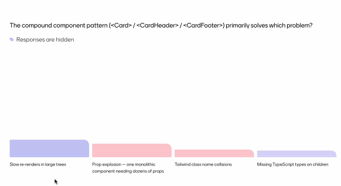
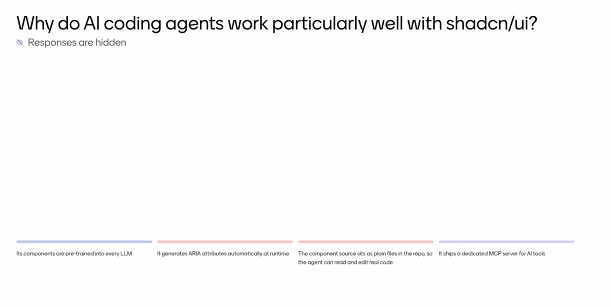

The correct answer is:

**"Components are copied into your repo, so you own the source"**

### Why this is the main difference

* **Source ownership vs. `node_modules`:** Traditional component libraries like Material UI (MUI) are installed as external dependencies in `node_modules`, meaning component internals live outside your codebase and customization often requires overriding library styles or props. `shadcn/ui` instead adds the component code directly into your project so you can read, modify, and tailor the markup, styling, and accessibility behavior directly.

### Why the other options are incorrect

* **It ships as an npm package with a smaller bundle:** `shadcn/ui` isn't distributed as a traditional monolithic UI component npm package that you import components from—rather, its CLI/templates place the component files directly into your repository (typically alongside underlying primitives such as Radix UI and utilities like Tailwind CSS).
* **It replaces Tailwind with its own styling engine:** `shadcn/ui` is built *around* Tailwind CSS (and CSS variables) for styling rather than replacing it with a proprietary styling engine.
* **It only works with Next.js:** Although it has great Next.js support, it also works with other React setups (such as Vite).

The correct answer is:

**"It provided unstyled primitives with keyboard behavior and ARIA wiring already handled"**

### Why this solves what Tailwind CSS doesn't

* **Styling vs. interactive accessibility behavior:** Tailwind CSS handles utility-first styling, not complex widget state, focus management, or screen-reader semantics. Radix UI provides unstyled ("headless") primitives that take care of tricky interaction details—such as keyboard navigation, focus trapping/restoration, open/closed state, and ARIA attributes—while leaving visual styling up to you (for example, via Tailwind CSS).

### Why the other options are incorrect

* **It eliminated the need for a build step:** Radix UI doesn't remove build steps in modern React/frontend workflows.
* **It introduced utility-first class composition:** That is the role of Tailwind CSS, not Radix UI.

* **It replaced CSS variables with design tokens:** Radix UI focuses on accessible primitive behavior rather than replacing CSS variables with a specific token format.

The correct answer is:

**"Prop explosion — one monolithic component needing dozens of props"**

### Why this is the primary problem solved

* **Composable slots instead of dozens of props:** Instead of passing endless configuration props (like `headerText`, `headerIcon`, `footerActions`, `showFooter`, `headerClassName`, etc.) into a single monolithic `<Card/>` component, the compound component pattern lets you compose sub-components (`<CardHeader/>`, `<CardContent/>`, `<CardFooter/>`) flexibly where they are used.

* **Cleaner layout and structure control:** Callers can arrange, omit, or customize individual sections naturally through JSX composition rather than fighting rigid prop combinations.

### Why the other options are incorrect

* **Slow re-renders in large trees:** React rendering performance is driven by state/prop updates and rendering patterns, not simply splitting a card into compound sub-components.

* **Tailwind class name collisions:** Tailwind uses utility classes composed directly on elements rather than relying on compound components to prevent class name collisions.

* **Missing TypeScript types on children:** Component composition doesn't inherently fix or cause missing TypeScript types on `children`.

The correct answer is:

**"The component source sits as plain files in the repo, so the agent can read and edit real code"**

### Why this helps AI coding agents

* **Direct visibility and editability:** Because `shadcn/ui` components live as standard source files inside your repository rather than hidden inside an external package, AI coding agents can inspect the actual implementation, understand existing props/variants/styles, and make direct edits in context.

* **Consistent patterns:** Having plain, readable component files in the repo makes it easier for agents to follow your project's actual conventions instead of guessing opaque internal library APIs.

### Why the other options are incorrect

* **Its components are pre-trained into every LLM:** LLMs aren't guaranteed to have every specific project component/version pre-trained into their weights, and agents rely on reading your actual codebase.

* **It generates ARIA attributes automatically at runtime:** Accessibility/ARIA behavior comes from semantic HTML and underlying primitives (such as Radix UI), not magical automatic runtime generation from `shadcn/ui` alone.

* **It ships a dedicated MCP server for AI tools:** That isn't the core reason it works well with AI coding agents in this question.