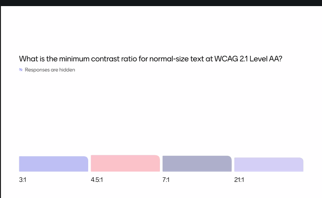
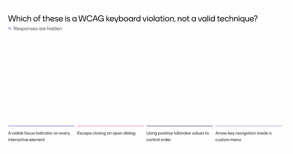
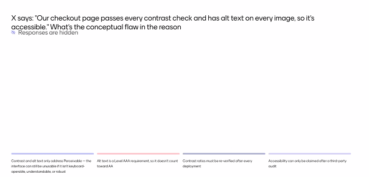
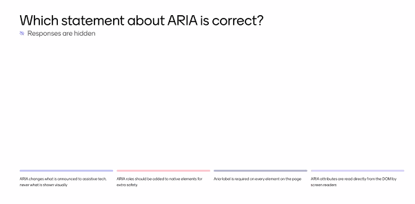
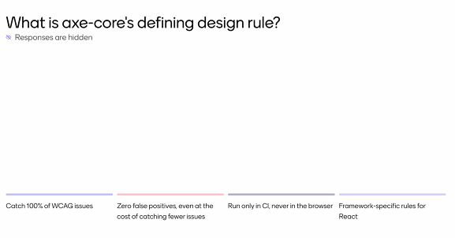
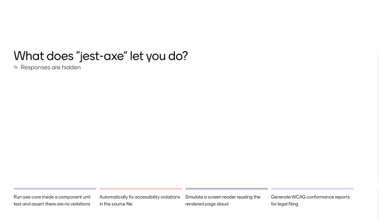
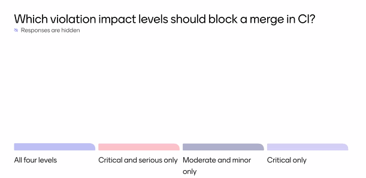
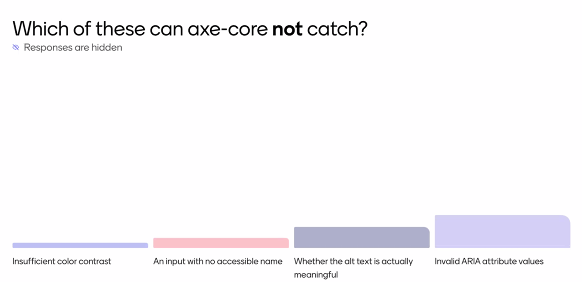
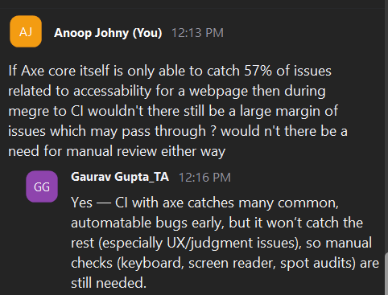

The correct answer is:

**4.5:1**

### Why 4.5:1 is the requirement

* **WCAG 2.1 Level AA normal text (SC 1.4.3 Contrast (Minimum)):** Normal-size text requires a minimum contrast ratio of **4.5:1** against its background so that text remains readable for users with moderately low vision (such as around 20/80 visual acuity).

### How the other options compare

* **3:1:** Applies to **large text** (generally at least 18pt / 24px regular, or 14pt / ~18.5px bold) at WCAG AA, as well as **non-text contrast** (UI components and graphical objects, SC 1.4.11)—not normal-size body text.
* **7:1:** Corresponds to the stricter **WCAG AAA** contrast requirement for normal-size text.
* **21:1:** The theoretical maximum contrast ratio (pure black `#000000` on pure white `#FFFFFF`), not the minimum threshold for Level AA.

The correct answer is:

**"Using positive tabindex values to control order"**

### Why this is an accessibility anti-pattern / violation

* **Disrupts natural tab order:** Positive `tabindex` values (`tabindex="1"`, `tabindex="2"`, etc.) force elements to the front of the keyboard tab sequence ahead of everything with default tab order (`0` or natural focusable elements), making focus order unpredictable and hard to maintain as layouts change.
* **Best practice:** Rely on clean semantic DOM order and use `tabindex="0"` (to add a non-focusable custom element into the natural tab order) or `tabindex="-1"` (for programmatic focus management) rather than positive integers.

### Why the other options are valid accessibility techniques

* **A visible focus indicator on every interactive element:** Essential for keyboard users to see where focus currently is (aligned with WCAG focus visibility requirements).
* **Escape closing an open dialog:** Standard, expected keyboard interaction for modal/non-modal dialogs and popovers.
* **Arrow-key navigation inside a custom menu:** Standard WAI-ARIA authoring pattern for composite widgets like menus, toolbars, tabs, and listboxes so users can move between items cleanly without excessive `Tab` presses.

The correct answer is:

**"Contrast and alt text only address Perceivable — the interface can still be unusable if it isn't keyboard-operable, understandable, or robust"**

### Why this is the conceptual flaw

* **POUR principles:** WCAG accessibility is built around four principles—**P**erceivable, **O**perable, **U**nderstandable, and **R**obust. Color contrast and image `alt` text speak primarily to making content *perceivable* (especially visually or via text alternatives), not whether a user can complete checkout using only a keyboard (*Operable*), understand form labels/error messages (*Understandable*), or rely on valid semantics/ARIA with assistive technologies (*Robust*).

### Why the other options are incorrect

* **Alt text is a Level AAA requirement, so it doesn't count toward AA:** Alternative text for non-text content is a foundational WCAG requirement (Level A), not a Level AAA exclusion.

* **Contrast ratios must be re-verified after every deployment:** While re-checking contrast after UI changes is good practice, that doesn't explain why passing contrast and alt text alone is conceptually insufficient to call a checkout page accessible.

* **Accessibility can only be claimed after a third-party audit:** Accessibility is evaluated against conformance criteria and real usability across POUR principles, not solely by whether an external auditor signed off.

The correct answer is:

**"ARIA changes what is announced to assistive tech, never what is shown visually"**

### Why this statement is correct

* **Semantics/announcements vs. visual rendering:** ARIA (`aria-*` attributes and roles) modifies information exposed to assistive technologies—such as roles, states, and properties—without altering visual appearance or adding built-in keyboard/focus behavior on its own. Because it doesn't change visuals automatically, keeping visual state and ARIA state in sync is crucial.

### Why the other options are incorrect

* **ARIA roles should be added to native elements for extra safety:** The first rule of ARIA is to prefer semantic native HTML elements (like `<button>`, `<nav>`, `<input>`) over adding redundant ARIA roles, which can be unnecessary or even introduce conflicts if misused.

* **Aria-label is required on every element on the page:** `aria-label` is only needed when an interactive or landmark element lacks a visible text label or needs an explicit accessible name—not on every DOM element.

* **ARIA attributes are read directly from the DOM by screen readers:** Screen readers interact with the browser's **accessibility tree** (built and updated by the browser from HTML semantics and ARIA attributes), not by directly scraping raw DOM attributes on their own.

The correct answer is:

**"Zero false positives, even at the cost of catching fewer issues"**

### Why this is `axe-core`'s defining design rule

* **High signal, low noise:** `axe-core` is designed around minimizing false positives so developers and automated test suites trust reported violations instead of ignoring noisy warnings. If a rule cannot determine accessibility with high confidence from the DOM/computed styles, it avoids guessing—meaning it intentionally leaves subtler or context-dependent checks to human/manual testing rather than flooding teams with false alarms.

### Why the other options are incorrect

* **Catch 100% of WCAG issues:** No automated accessibility engine can catch 100% of WCAG issues because many criteria require human judgment, real keyboard/screen-reader flows, or content comprehension.

* **Run only in CI, never in the browser:** `axe-core` runs directly inside browser environments (including browser extensions, Playwright/Cypress/Selenium browser contexts, and local dev workflows), not solely in CI.

* **Framework-specific rules for React:** `axe-core` evaluates the rendered DOM and accessibility semantics rather than being limited to React-specific rules.

The correct answer is:

**"Run axe-core inside a component unit test and assert there are no violations"**

### Why this is what `jest-axe` does

* **Automated assertions in Jest tests:** `jest-axe` provides Jest matchers (such as `toHaveNoViolations()`) that run `axe-core` against a rendered DOM node/container inside your unit or component tests so you can fail tests automatically if accessibility violations are introduced.

### Why the other options are incorrect

* **Automatically fix accessibility violations in the source file:** `jest-axe` detects and asserts against violations in rendered output; it does not rewrite your source code files automatically.

* **Simulate a screen reader reading the rendered page aloud:** It inspects DOM/accessibility rules programmatically rather than acting as a spoken screen-reader simulator.

* **Generate WCAG conformance reports for legal filing:** Automated unit-test assertions catch common DOM issues during development, not formal legal conformance filings.

The standard CI gating answer here is:

**"Critical and serious only"**

### Why "Critical and serious only" is the practical CI baseline

* **High impact on assistive tech users:** In `axe-core`, violations are ranked into four impact levels—**minor**, **moderate**, **serious**, and **critical**. **Critical** and **serious** issues represent severe barriers (such as missing accessible names, broken form labels, or severe contrast/semantic failures) that can block users with disabilities from completing core workflows.

* **Balanced velocity in CI:** Blocking merges on high-severity regressions prevents major accessibility bugs from landing in production while keeping pull requests moving, whereas **moderate** and **minor** items are often logged as warnings or tracked for follow-up rather than halting every merge.

### Why the other options are less typical as a default rule

* **All four levels:** Can create friction or false-urgency on minor/moderate findings when a team is rolling out automated accessibility checks across an existing codebase.

* **Moderate and minor only:** Inverts severity—allowing severe accessibility blockers into the main branch while blocking on lower-impact issues.

* **Critical only:** May let significant barriers (such as certain missing labels or contrast problems classified as **serious**) slip through into production.

The correct answer is:

**"Whether the alt text is actually meaningful"**

### Why `axe-core` cannot catch this

* **Semantic/contextual judgment vs. DOM presence:** `axe-core` can verify whether an image has an `alt` attribute (or `role="presentation"`/`alt=""` when decorative), but it cannot judge whether the *words* written inside `alt="..."` accurately or meaningfully describe what the image conveys in context. For example, `alt="image123.jpg"` or `alt="photo"` satisfies the presence of alt text syntactically while failing real-world usefulness for a screen-reader user.

### Why the other options *can* be caught by `axe-core`

* **Insufficient color contrast:** `axe-core` checks computed foreground and background colors against WCAG contrast thresholds (such as 4.5:1 for normal text).

* **An input with no accessible name:** `axe-core` detects form controls missing an associated `<label>`, `aria-label`, or `aria-labelledby`.

* **Invalid ARIA attribute values:** `axe-core` validates ARIA roles, states, and property values against ARIA specifications.

