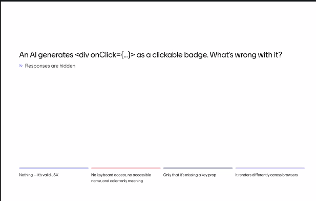
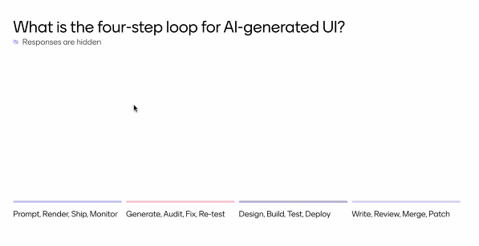
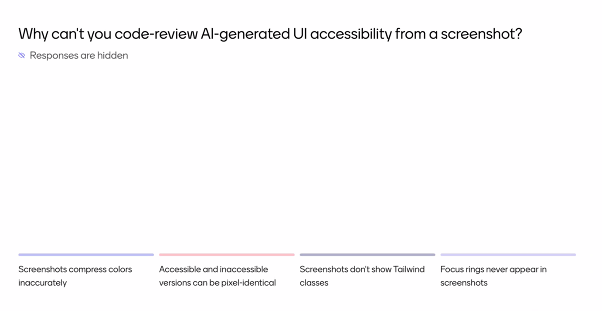
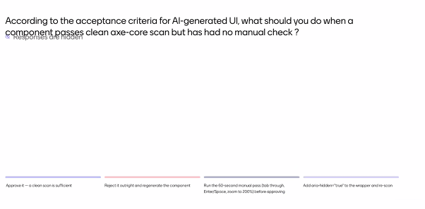
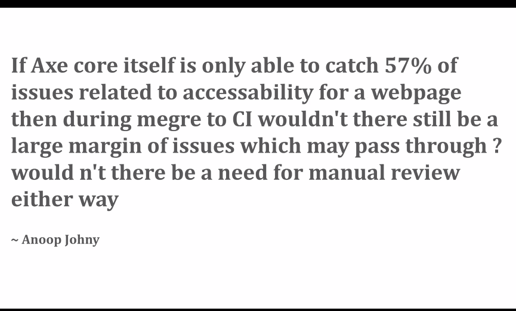

The correct answer is:

**"No keyboard access, no accessible name, and color-only meaning"**

### Why `
` is problematic for a clickable badge

* **Not keyboard-operable by default:** A plain `
` is not focusable via `Tab` and does not trigger on `Enter` or `Space` the way a native `<button>` does, making it inaccessible to keyboard-only and switch/assistive-technology users.
* **Missing interactive semantics / accessible name:** Without a native interactive element (like `<button>`) or proper role/labeling, assistive technologies don't treat it as a button or reliably expose its purpose/state in the accessibility tree.
* **Color-only meaning risk:** Badges often convey status (like success, warning, or error) through color alone; if status isn't also conveyed via text, icons, or labels, color-blind users or screen-reader users can miss the meaning.

### Why the other options are incorrect

* **Nothing — it's valid JSX:** Valid JSX syntax only means React can compile/render it—it says nothing about accessibility or keyboard usability.
* **Only that it's missing a key prop:** A `key` prop is only needed when rendering items inside a dynamic list (`.map()`), not for making an element accessible.
* **It renders differently across browsers:** Standard `
` rendering is consistent across modern browsers; the issue is semantic and interactive accessibility rather than cross-browser `
` layout quirks.

The correct answer is:

**"Generate, Audit, Fix, Re-test"**

### Why this is the loop for AI-generated UI

* **Generate:** An AI model or coding agent produces UI markup, components, or styles.

* **Audit:** The rendered UI is evaluated for accessibility issues using automated checks (such as `axe-core`) alongside targeted keyboard and semantic checks.

* **Fix:** Detected accessibility issues—such as missing accessible names, keyboard traps, semantic roles, or contrast problems—are corrected in the component code.

* **Re-test:** The updated UI is re-audited to verify that the fixes resolved the issues without introducing new regressions before merging or shipping.

### Why the other options are incorrect

* **Prompt, Render, Ship, Monitor:** Ships generated UI straight to production/monitoring without an explicit accessibility audit-and-fix verification step.

* **Design, Build, Test, Deploy:** Describes a general software/product delivery lifecycle rather than the specific iterative loop for auditing and remediating AI-generated UI.

* **Write, Review, Merge, Patch:** Focuses on general code-change and release flow rather than the targeted accessibility verification loop for AI-generated UI.

The correct answer is:

**"Accessible and inaccessible versions can be pixel-identical"**

### Why screenshots aren't enough for accessibility review

* **Visuals hide semantics and keyboard behavior:** A static screenshot only captures rendered pixels—it cannot show whether a clickable control is a real `<button>` or a non-keyboard-accessible `
`, whether form inputs have programmatic labels, whether ARIA attributes are valid, or how focus moves with `Tab` and `Escape`.

* **Pixel-identical traps:** Two versions of a UI element can look completely identical on screen while one is keyboard-operable and screen-reader-friendly and the other is broken for assistive technologies.

### Why the other options are incorrect

* **Screenshots compress colors inaccurately:** While image compression or color profiles can affect raw image files, that's not the core reason you can't verify DOM semantics, keyboard navigation, or ARIA state from a screenshot.

* **Screenshots don't show Tailwind classes:** Even if you could see class names, utility classes don't guarantee proper semantic HTML, ARIA wiring, or keyboard interactions.

* **Focus rings never appear in screenshots:** Focus indicators *can* appear if an element is focused when the screenshot is taken, so that statement is false.

The correct answer is:

**"Run the 60-second manual pass (tab through, Enter/Space, zoom to 200%) before approving"**

### Why this is the right acceptance step

* **Automated scans don't cover everything:** Because `axe-core` prioritizes zero false positives and only checks objective DOM/style rules, a passing scan does not guarantee real keyboard operability, logical focus flow, or layout/text scaling behavior.
* **Fast human verification:** A quick manual pass—tabbing through interactive elements, activating controls with `Enter`/`Space` (and checking `Escape`/focus traps where relevant), and zooming to 200%—catches practical usability and visual-reflow issues before sign-off.

### Why the other options are incorrect

* **Approve it — a clean scan is sufficient:** Automated scans catch only a subset of accessibility issues, so passing `axe-core` alone isn't enough for full acceptance.
* **Reject it outright and regenerate the component:** If the automated scan is clean, regenerating blindly isn't necessary before doing a quick manual check—you can inspect and fix any real issues found during the pass.
* **Add aria-hidden="true" to the wrapper and re-scan:** Hiding a component from assistive technologies doesn't make it accessible; it removes it from the accessibility tree altogether.

